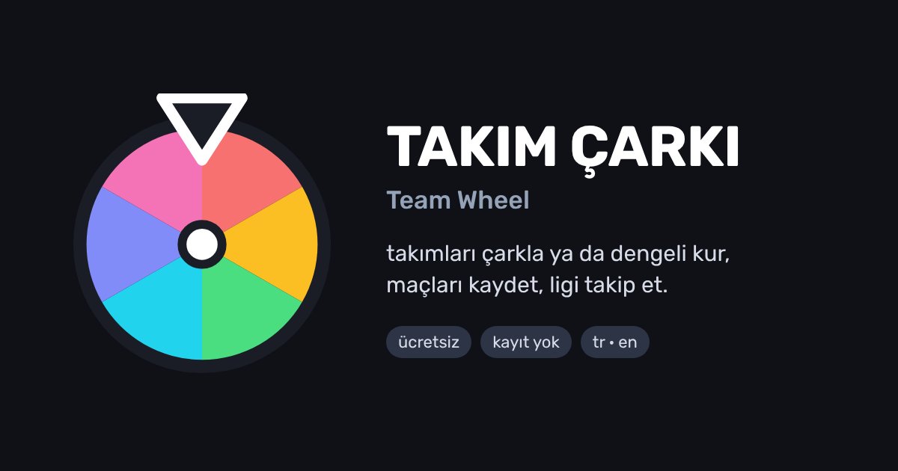

# Takım Çarkı · Team Wheel

**🎡 Uygulamayı aç / Open the app: https://cihan-senturk.github.io/team-wheel/**

---

## Türkçe

Oyun gecelerimizden doğan, tarayıcıda çalışan bir takım kurma çarkı ve lig tablosu.

### Neler yapabilirsin?

- **Takım kur:** Oyuncuları çarkla tek tek seç ya da tek tıkla rastgele veya kazanma oranına göre dengeli dağıt.
- **Son takımlar tekrar gelmesin:** İstersen çark ve rastgele kurulum, son maçın takımlarının aynısını kurmaz.
- **Maçları kaydet:** Kazanan takımı işaretle; lig tablosu, seriler ve maç geçmişi kendiliğinden güncellenir.
- **Adil sıralama:** Herkes aynı sayıda maç oynamak zorunda değil. Sıralama, az maç oynayanları %50'ye doğru çeken bir puanla yapılır.
- **Düzelt ve geri al:** Galibiyet/mağlubiyet sayılarını düzelt, son sonucu geri al, geçmişten maç sil, oyuncu adını değiştir.
- **Rövanş ve sürükle-bırak:** Aynı takımlarla tekrar oyna ya da bir oyuncuyu sürükleyerek öbür takıma taşı.
- **Paylaş:** Takımları ya da lig tablosunu WhatsApp, Telegram, X, e-posta veya görsel olarak paylaş.
- **Kişiselleştir:** Takım ve lig adları, Türkçe/İngilizce, gece/gündüz modu, ses seviyesi.

### Gizlilik

Kayıt yok, sunucu yok. Tüm veriler yalnızca kendi tarayıcında saklanır. Ligini başka bir cihaza taşımak için **yedeği indir** ve diğer cihazda **yedeği yükle**.

---

## English

A team picker wheel and league table that runs in your browser, born from our gaming nights.

### What can you do?

- **Pick teams:** Spin the wheel one player at a time, or split everyone instantly — randomly or balanced by win rate.
- **No repeat teams:** Optionally, the wheel and random setup won't recreate the teams from the last match.
- **Record matches:** Mark the winning team; the league table, streaks and match history update automatically.
- **Fair ranking:** Not everyone has to play the same number of matches. Players are ranked by a rating that pulls players with few games toward 50%.
- **Fix and undo:** Adjust win/loss counts, undo the last result, delete matches from the history, rename players.
- **Rematch and drag & drop:** Play again with the same teams, or drag a player to the other team.
- **Share:** Share the teams or the league table via WhatsApp, Telegram, X, email or as an image.
- **Make it yours:** Team and league names, Turkish/English, dark/light mode, volume.

### Privacy

No sign-up, no server. All data is stored only in your browser. To move your league to another device, use **download backup** and **restore backup** on the other device.

---

Tek bir `index.html` dosyası; kurulum ya da derleme gerektirmez. · A single `index.html` file; no install or build step.
